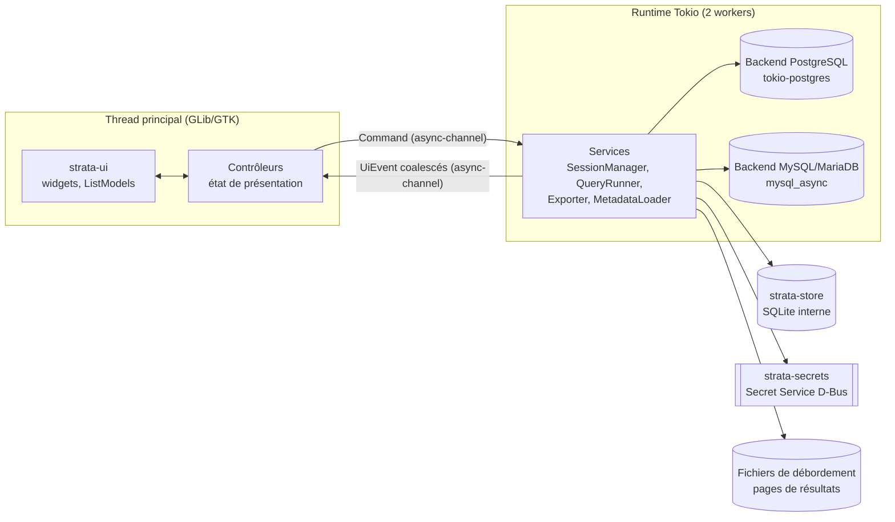
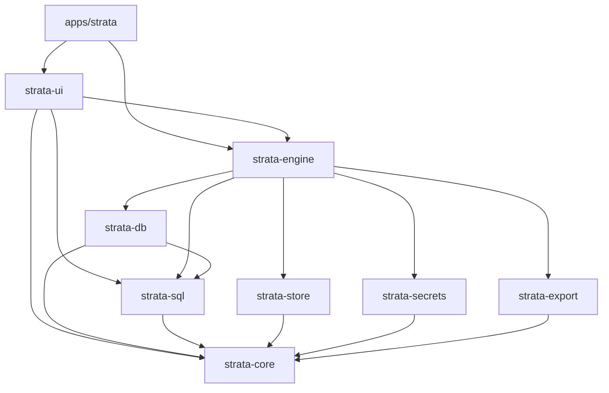
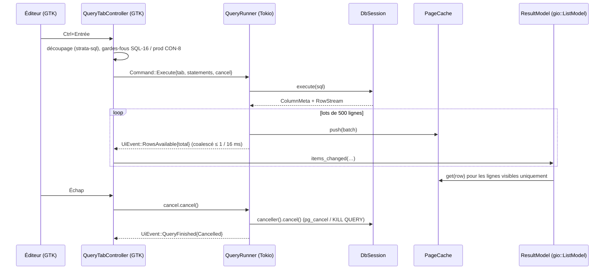
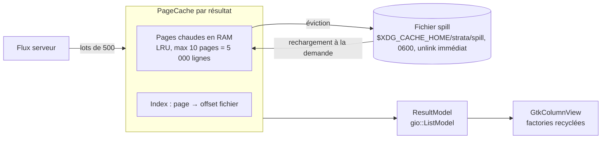
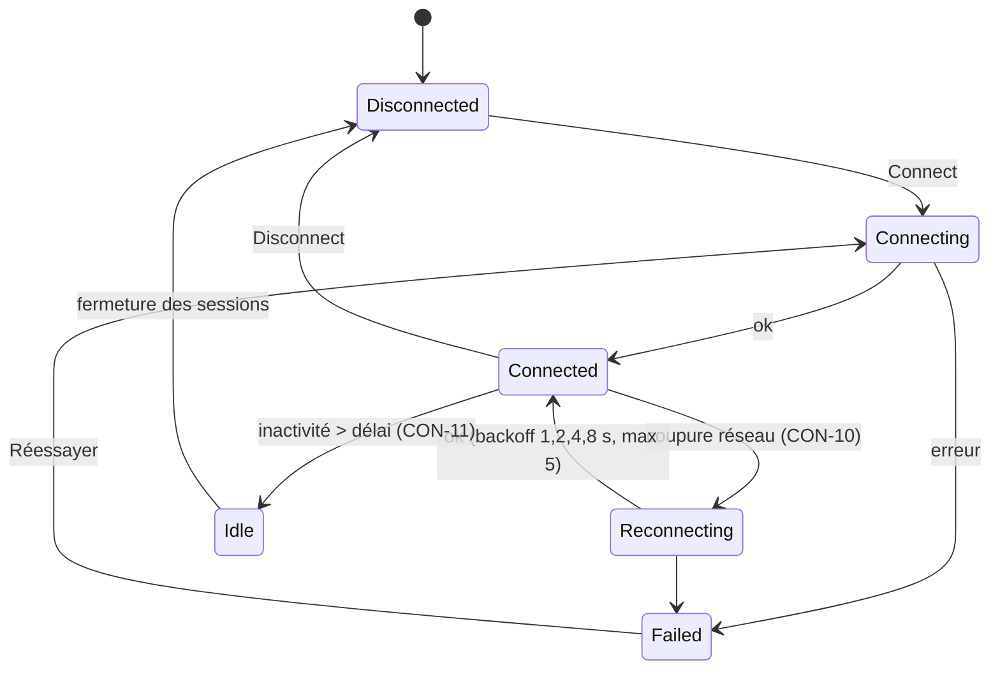
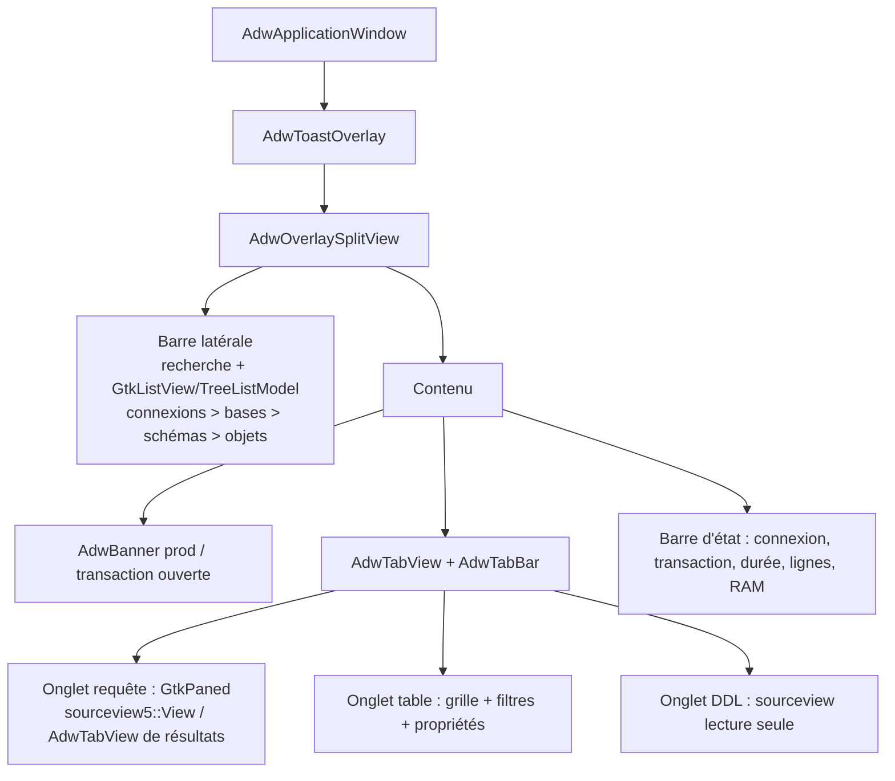

# Strata — Architecture

> Statut : **proposition J0, en attente de validation**.
> Document de référence technique. Les décisions structurantes sont détaillées dans `docs/ADR/`.
> Le cahier des charges (`CDC.md`) fait foi en cas de divergence.

---

## 1. Vue d'ensemble

Strata est un **processus unique** Rust composé de deux mondes qui ne partagent jamais de thread :

- **Thread principal GTK** : boucle GLib, widgets GTK4/libadwaita, modèles `gio::ListModel`. Aucune I/O réseau, aucun calcul lourd.
- **Runtime Tokio** (multi-thread, **2 workers**) : drivers de bases de données, export, parsing de gros scripts, accès disque non trivial.

Ils communiquent par **messages typés** sur des canaux `async-channel` (cf. ADR-0003).



---

## 2. Découpage en crates

```
strata/
├── Cargo.toml                 # workspace, profil release, lints communs
├── crates/
│   ├── strata-core/           # domaine : types, erreurs, CancelToken, Value compacte, traits
│   ├── strata-db/             # trait DbBackend/DbSession + backends (features `postgres`, `mysql`)
│   │   └── src/{postgres,mysql}/
│   ├── strata-sql/            # découpeur de scripts, classification, formatage, auto-complétion, Dialect
│   ├── strata-store/          # SQLite interne (rusqlite), migrations user_version, FTS5
│   ├── strata-secrets/        # abstraction trousseau (oo7) + implémentation mémoire pour tests
│   ├── strata-export/         # writers streaming CSV/TSV/JSON/JSONL/SQL INSERT
│   ├── strata-engine/         # services async (sessions, exécution, pagination, spill) — SANS GTK
│   └── strata-ui/             # GTK4/libadwaita/sourceview5 — le SEUL crate dépendant de GTK
├── apps/strata/               # binaire : CLI args, logs, runtime Tokio, allocateur, lancement UI
├── xtask/                     # cargo xtask bench-mem, dist, i18n
├── data/                      # .desktop, AppStream, schéma GSettings, icônes, ressources .ui/.css
├── packaging/                 # flatpak (manifest), deb
├── po/                        # traductions gettext (LINGUAS, POTFILES, fr.po)
├── tests/                     # intégration testcontainers (PG 14–17, MySQL 8, MariaDB 10.11/11)
└── docs/
```

**Écart par rapport au CDC §6.1** : ajout de `strata-engine` et `xtask`.

- `strata-engine` contient l'orchestration asynchrone (gestion des sessions, cache de pages, reconnexion, inactivité, historique). Sans lui, cette logique finirait dans `strata-ui` et deviendrait intestable sans affichage, contrairement à la règle du CDC.
- `xtask` porte le banc mémoire (`cargo xtask bench-mem`) exigé par §12.

### Graphe de dépendances



Règles vérifiées en CI (`cargo deny` + un test `cargo tree`) :
- `gtk4`, `libadwaita`, `sourceview5`, `glib` n'apparaissent **que** sous `strata-ui` et `apps/strata`.
- `strata-core` n'a aucune dépendance lourde (pas de tokio runtime, uniquement `tokio-util` pour le jeton d'annulation si nécessaire, `thiserror`, `bytes`).

---

## 3. Types du domaine (`strata-core`)

| Type | Rôle |
|---|---|
| `ConnectionConfig` | id, nom, `DbKind`, `Endpoint` (`Tcp{host,port}` / `UnixSocket{path}`), base, utilisateur, `TlsConfig`, `Environment` (dev/staging/prod), couleur, groupe, `read_only`, `PasswordPolicy` (`Keyring` / `AskEveryTime` / `ClientConfigFile` — ADR-0014), `record_history` |
| `Secret` | mot de passe en `zeroize::Zeroizing<String>`, `Debug` masqué, jamais sérialisable |
| `Value` | enum compacte (≤ 16 octets) : `Null`, `Bool`, `I64`, `F64`, `Text(Box<str>)`, `Bytes(Box<[u8]>)`, `Truncated{preview, total_len}`, `Date/Time/Timestamp/TimestampTz` (entiers), `Decimal(Box<str>)`, `Json(Box<str>)`, `Other(Box<str>)` |
| `ColumnMeta` | nom, type serveur, `ValueKind`, nullable, table/colonne d'origine si connue (pour GRD-7) |
| `RowBatch` | `Vec<Box<[Value]>>` (≤ 500 lignes), stockage en ligne contiguë |
| `CancelToken` | alias de `tokio_util::sync::CancellationToken` |
| `StrataError` | `thiserror` : `Connection`, `Auth`, `Tls`, `Server{sqlstate, message, position, detail, hint}`, `Cancelled`, `Timeout`, `Io`, `Unsupported` |

---

## 4. Abstraction base de données (`strata-db`)

Le trait du CDC §6.2 est **scindé en deux** (cf. ADR-0002) : un serveur se connecte (`DbDriver`) et produit des **sessions** physiques (`DbSession`). Une session = une connexion réseau = un état transactionnel. Cela rend `begin/commit/rollback` non ambigus et colle à l'hypothèse 4 (1 session métadonnées + 1 session par onglet actif).

```rust
#[async_trait]
pub trait DbDriver: Send + Sync {
    fn kind(&self) -> DbKind;
    fn dialect(&self) -> &'static dyn Dialect;
    async fn connect(&self, cfg: &ConnectionConfig, secret: Option<Secret>)
        -> Result<Box<dyn DbSession>>;
}

#[async_trait]
pub trait DbSession: Send {
    async fn ping(&mut self) -> Result<()>;
    async fn server_info(&mut self) -> Result<ServerInfo>;

    // Métadonnées — paresseuses, appelées uniquement au dépliage d'un nœud
    async fn list_databases(&mut self) -> Result<Vec<DbName>>;
    async fn list_schemas(&mut self, db: &DbName) -> Result<Vec<SchemaName>>;
    async fn list_objects(&mut self, s: &SchemaRef, kind: ObjectKind) -> Result<Vec<ObjectInfo>>;
    async fn describe_table(&mut self, t: &TableRef) -> Result<TableDetails>;
    async fn object_ddl(&mut self, o: &ObjectRef) -> Result<String>;

    // Exécution
    async fn execute(&mut self, sql: &str, params: &[Value], cancel: CancelToken)
        -> Result<Execution>; // Execution::Rows(RowStream) | Execution::Done(ExecSummary)

    // Transactions
    async fn begin(&mut self, read_only: bool) -> Result<()>;
    async fn commit(&mut self) -> Result<()>;
    async fn rollback(&mut self) -> Result<()>;
    fn in_transaction(&self) -> bool;

    /// Jeton pouvant annuler la requête en cours depuis une autre tâche
    /// (pg CancelToken / `KILL QUERY <id>` sur une connexion annexe).
    fn canceller(&self) -> Box<dyn Canceller>;
}
```

`RowStream` est un `Stream<Item = Result<RowBatch>>` précédé des `ColumnMeta`. Il **n'avance que lorsqu'on le consomme** : la contre-pression TCP limite naturellement la mémoire.

`Dialect` (dans `strata-sql`) : quoting d'identifiants, littéraux, `LIMIT/OFFSET`, placeholders (`$1` vs `?`), mots-clés et fonctions pour la coloration/complétion, génération `INSERT/UPDATE/DELETE` paramétrés pour la grille.

---

## 5. Modèle d'exécution et flux d'une requête



### 5.1 Commandes et événements

- `Command` (UI → moteur) : `Connect`, `Disconnect`, `TestConnection`, `LoadChildren{node}`, `Execute`, `Cancel`, `FetchMore{result}`, `ApplyEdits`, `Export`, `Begin/Commit/Rollback`…
- `UiEvent` (moteur → UI) : `ConnectionState`, `NodeChildren`, `ColumnsReady`, `RowsAvailable`, `QueryFinished{summary|error}`, `TxState`, `ExportProgress`, `Toast`…
- **Coalescing** : le moteur fusionne les `RowsAvailable` et `ExportProgress` d'une même cible dans une fenêtre de 16 ms ; l'UI ne reçoit jamais plus d'environ 60 messages/s par flux.

### 5.2 Annulation
Chaque opération longue reçoit un `CancelToken`. L'annulation (1) déclenche l'annulation côté serveur, (2) abandonne le flux, (3) l'UI repasse immédiatement en état « annulé » sans attendre l'accusé serveur (budget ≤ 200 ms).

---

## 6. Résultats : pagination, cache, débordement (cf. ADR-0008)



- **Lecture à la demande** : on lit les 500 premières lignes, puis on ne lit le flux que lorsque le défilement approche de la fin des lignes connues (ou en continu si l'utilisateur demande « tout récupérer » / un export).
- **Fenêtre glissante** : au plus 10 pages en RAM ; les pages évincées sont sérialisées (format binaire compact) dans un fichier de débordement **anonyme** (supprimé dès l'ouverture, disparaît à la fermeture du descripteur ou en cas de crash).
- **Ouverture de table** (vs requête libre) : pas de spill ; pagination **keyset** sur la clé primaire, tri et filtre côté serveur (GRD-2, GRD-3).
- **Onglets inactifs** : après N minutes non visibles, le `PageCache` est libéré, le fichier fermé, la requête conservée pour ré-exécution (règle §5.3).
- Les `ResultModel` exposent des items **légers** (`RowRef{index}`) ; le texte des cellules est produit au `bind` de la factory et non stocké.

---

## 7. Gestion des sessions et du cycle de vie



- `SessionManager` (moteur) : par connexion, 1 session métadonnées + 1 session par onglet de requête **ayant exécuté** quelque chose (ouverture paresseuse).
- Une session avec une **transaction ouverte n'est jamais fermée automatiquement** ni reconnectée silencieusement : l'utilisateur est averti (perte de transaction).
- Lecture seule (CON-12) : `SET SESSION CHARACTERISTICS AS TRANSACTION READ ONLY` (PG) / `SET SESSION TRANSACTION READ ONLY` (MySQL) **et** garde client via la classification des instructions de `strata-sql`.

---

## 8. Interface (`strata-ui`)

**Fenêtre unique à onglets** (ADR-0015) : une seule `AdwApplicationWindow` ; une seconde invocation de `strata` réactive la fenêtre existante (`GApplication` unique) et lui transmet ses arguments.



- L'arbre utilise `GtkTreeListModel` dont la fonction `create_model` envoie `Command::LoadChildren` et renvoie un `gio::ListStore` vide rempli à l'arrivée de `NodeChildren` (nœud « chargement… » pendant l'attente) — NAV-2.
- Toutes les chaînes via `gettext` (`gettextrs::gettext`, macros `i18n!`), interfaces décrites en `.ui`/Blueprint compilées dans une `gio::Resource`.
- Les contrôleurs (état de présentation : onglet, transaction, modifications en attente de la grille) sont des structs Rust **testables sans GTK** ; les widgets ne font que refléter cet état.

---

## 9. Stockage interne (`strata-store`)

- `$XDG_DATA_HOME/strata/strata.db`, créé en `0600`, répertoire en `0700`, `journal_mode=WAL`, `foreign_keys=ON`.
- Migrations embarquées, numérotées, appliquées selon `PRAGMA user_version` (la table `meta` du CDC est remplacée par `user_version` + une table `meta(key, value)` pour les informations annexes).
- Tables : `connections`, `groups`, `history` + `history_fts` (FTS5, `content='history'`, déclencheurs de synchronisation), `snippets`, `tabs_state`, `meta`.
- Accès : une connexion `rusqlite` dédiée, utilisée depuis le runtime via `spawn_blocking` (opérations courtes) ; le thread principal n'y touche jamais.
- **Aucun secret** dans SQLite : seulement `secret_ref` (attributs de recherche dans le trousseau). Un test d'intégration vérifie l'absence du mot de passe dans le fichier.

---

## 10. Sécurité (synthèse, cf. ADR-0004)

- Secrets : Secret Service via `oo7` (portail Secret en Flatpak). Si indisponible → stockage refusé, mode « demander à chaque fois » proposé.
- `Secret` : `Zeroizing`, pas de `Debug`/`Display`/`Serialize` révélant la valeur.
- TLS : `rustls` + `rustls-platform-verifier`/certificats système, `prefer` par défaut, bannière d'avertissement si non chiffré vers un hôte non local.
- Logs `tracing` : aucune valeur de donnée ; SQL uniquement au niveau `trace` derrière une cible dédiée (`strata::sql`) désactivée par défaut.
- Aucune requête réseau autre que vers les bases configurées (pas de vérification de mise à jour).

---

## 11. Mesure mémoire (`xtask bench-mem`)

- Lance le binaire release avec `STRATA_BENCH_SCENARIO=<nom>` ; le binaire exécute le scénario en mode automatisé (ouverture de connexion, dépliage de l'arbre, requête de 1 M lignes et défilement programmatique…) puis signale « prêt ».
- `xtask` lit `/proc/<pid>/smaps_rollup` (PSS) à intervalles, sous `weston --backend=headless` / `xvfb-run`, et produit `target/bench-mem.json`.
- Comparaison à `bench/baseline.json` (mesures réelles du dernier jalon validé) : la CI échoue sur une **régression** de plus de 10 % par rapport à la référence. Les budgets du CDC §5 sont des **objectifs** affichés dans le rapport, pas des seuils bloquants (ADR-0013).
- Bases de test via `testcontainers` (PG avec 500 tables générées, table de 1 M × 10).

---

## 12. Risques identifiés

| Risque | Impact | Mitigation |
|---|---|---|
| **Renderer GPU GTK4** (`ngl`/`vulkan`) : 20–60 Mo de PSS en plus (pilotes Mesa, shaders, atlas) | Budget J0 « fenêtre vide ≤ 40 Mo » probablement dépassé | Accepté (ADR-0013) : mesure documentée, renderer par défaut conservé |
| libadwaita + icônes + polices chargés au démarrage | +10–15 Mo | Ressources minimales, pas de thème d'icônes complet embarqué |
| `sqlparser-rs` ne couvre pas tout le SQL PostgreSQL/MySQL | Complétion incorrecte | Complétion tolérante basée sur un tokenizer + parse partiel ; jamais bloquant pour l'exécution |
| `DELIMITER` MySQL et `$$` PG dans le découpeur | Exécution erronée | Découpeur maison basé sur un lexer, testé par `proptest` |
| Annulation MySQL nécessite une 2e connexion (`KILL QUERY`) | Latence d'annulation | Connexion d'annulation ouverte à la demande, réutilisée ; l'UI n'attend pas |
| Transaction PG ouverte pendant la lecture paresseuse d'un gros résultat | Snapshot long côté serveur | Option « tout récupérer en arrière-plan » + avertissement après N minutes |

---

## 13. Environnement de développement constaté (16/11/2026)

Machine : Ubuntu 26.04 LTS. **Absents** : toolchain Rust, `pkg-config`, en-têtes GTK4/libadwaita/GtkSourceView 5, `heaptrack`. Docker présent (testcontainers OK). Paquets requis : voir `docs/ROADMAP.md`, tâche J0-1.
